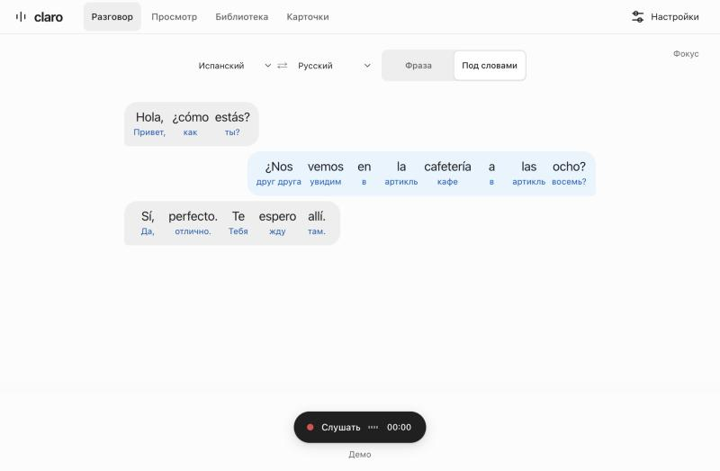
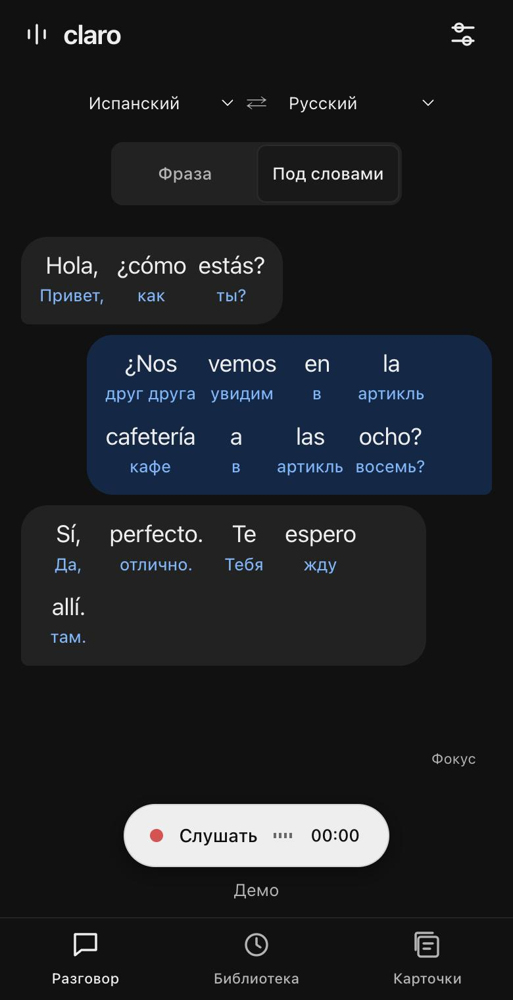

# Claro

Локальные субтитры и перевод живой речи в реальном времени. Речь распознаётся и переводится на твоём Mac: без облака, аналитики и npm-зависимостей. Приложение — веб-клиент на `http://127.0.0.1:4317`, который также открывается на телефоне.

**Статус:** ранняя версия 0.12.0. Основной сценарий — разговор или видео на испанском, английском или русском с переводом в реальном времени. Код под лицензией MIT. У моделей свои лицензии.

<p align="center">
  
  
</p>

## Установка

Нужны **macOS 14+**, **Apple Silicon**, около **6 ГБ свободного места** и **8+ ГБ RAM** (рекомендуется 16 ГБ).

Вставь в Терминал одну команду и дождись окончания установки.

```sh
curl -fsSL https://raw.githubusercontent.com/radmirooch/claro/main/install.sh | bash
```

Затем — **двойной клик по Claro.command** в домашней папке `Applications`. Окно откроется автоматически. Окно Терминала остаётся открытым, его закрытие останавливает Claro.

Установщик проверяет Node.js 22.13+, git и uv, размещает проект в `~/Claro`, устанавливает распознавание, перевод и значения слов. Уже установленный Node.js используется сразу, установка через Homebrew запрашивает подтверждение. Другой каталог можно задать переменной `CLARO_HOME`. Повторный запуск использует скачанные модели и сохраняет существующие настройки.

Для уже скачанного репозитория выполни `./install.sh`. Ручная установка, вариант `--lite`, другие платформы и удаление описаны в [docs/setup.md](docs/setup.md).

## Как пользоваться

1. **Разговор.** Выбери языки и нажми «Слушать». Реплики появляются облачками, перевод — под каждым словом или под фразой. Нажми на слово, чтобы увидеть значение и пример.
2. **Просмотр.** В Chrome или Edge открой «Просмотр» → «Выбрать вкладку», выбери вкладку с видео и отметь «Поделиться звуком вкладки». «Окно поверх видео» держит субтитры над роликом.
3. **Библиотека.** Все разговоры и просмотры сохраняются на твоём Mac. Их можно открыть, переименовать, выгрузить в TXT/JSON или удалить.
4. **Карточки.** В окне слова нажми «В карточки», а потом повторяй слова в разделе «Карточки»: пробел — показать ответ, 1–4 — оценка.

Чтобы просто посмотреть, как это выглядит, нажми «Показать пример» на пустом экране.

## Что умеет

- **Живые субтитры с микрофона.** Основной движок — Qwen3-ASR 0.6B (MLX, Apple Silicon). Whisper.cpp можно выбрать для сравнения.
- **Просмотр видео и подкастов.** В Chrome и Edge на компьютере можно выбрать вкладку со звуком и читать субтитры с переводом. В окне выбора нужно отметить «Поделиться звуком вкладки». Доступность системного звука зависит от браузера и системы. Просмотры сохраняются отдельными сессиями в библиотеке.
- **Окно поверх видео** в Chrome и Edge 116+ показывает последние реплики и черновик. Нажатие на слово открывает готовое значение прямо в окне. Для расчёта значений выбери «Под словами». Закрытие окна сохраняет субтитры. При отсутствии поддержки интерфейс показывает причину, на телефоне раздел «Просмотр» скрыт.
- **Перевод фраз** через локальную Ollama (по умолчанию TranslateGemma 4B), с потоковой выдачей.
- **Подстрочный перевод:** значение под каждым словом (Qwen3 4B через Ollama), полностью, без обрезки.
- **Четыре режима перевода:** всегда, по нажатию, «подготовить и скрыть» (peek: нажми на слово или облачко) и без перевода.
- **Два режима чтения:** «Спокойно» — в ленту попадают только готовые фразы, черновик показан отдельно. «Сразу» — лента обновляется по ходу распознавания.
- 10 языков, обмен языков местами, RTL для арабского.
- Ручная разметка участников (имя, цвет, «Я»). Автоматического распознавания голосов нет.
- **Карточки с интервальным повторением.** Нажми на слово с готовым значением и выбери «В карточки»: сохранятся значение и пример из реплики. В разделе «Карточки» доступны повторение с четырьмя оценками, изменение и удаление. Карточки остаются после удаления разговора.
- Локальная история в SQLite с восстановлением текущего разговора, экспорт TXT/JSON. Аудио нигде не сохраняется.
- Телефон: по локальной сети (HTTPS + код) или через временный туннель Cloudflare.
- JSON API, SSE и шина модулей для будущих клиентов и расширений.

## Документация

| Документ | О чём |
| --- | --- |
| [docs/architecture.md](docs/architecture.md) | Как устроено: компоненты, поток данных, API, очереди, контракты расширений |
| [docs/setup.md](docs/setup.md) | Установка, модели, переменные окружения |
| [docs/remote-access.md](docs/remote-access.md) | Телефон: локальная сеть и туннель Cloudflare |
| [docs/roadmap.md](docs/roadmap.md) | Куда движемся: модули, этапы, профили |
| [docs/benchmarks/](docs/benchmarks/) | Замеры скорости и качества на M4 |
| [CHANGELOG.md](CHANGELOG.md) | История версий 0.1–0.12 |
| [CONTRIBUTING.md](CONTRIBUTING.md) | Как вносить изменения |

## Проверка

```sh
npm test
```

Тесты используют синтетические данные и заглушки движков. Модели, микрофон и сеть для них не нужны. CI запускает тесты на Node 22 и 24.

## Приватность

- Аудио идёт из браузера на localhost, оттуда к локальному ASR. Текст уходит в локальную Ollama. Адреса провайдеров принимаются только loopback.
- Текст разговоров вместе с переводами, значениями слов и участниками сохраняется локально в `data/claro.sqlite`. Сохранение отключается настройкой «Сохранять разговоры» или через `CLARO_STORAGE=off`. Аудио по-прежнему не сохраняется. Карточки с примерами сохраняются в той же базе по явному нажатию «В карточки»; `CLARO_STORAGE=off` отключает и их. В localStorage лежат только настройки и профили участников.
- Сервер слушает только `127.0.0.1`. Не открывай его в интернет напрямую. Для телефона есть отдельные мосты с авторизацией, см. [remote-access](docs/remote-access.md).

## Лицензии

Код приложения — MIT. Whisper.cpp, Ollama и веса моделей лицензируются отдельно: TranslateGemma — [Gemma Terms](https://ai.google.dev/gemma/terms), Qwen3-ASR и реализация MLX — Apache 2.0. Веса не входят в репозиторий.
